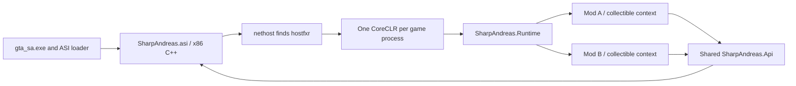

# SharpAndreas

**An AI-made project, developed with human assistance as QA and code reviewer.** Automated checks are included; this credit does not mean every API or gameplay behavior has been verified inside GTA.

A 32-bit C++ ASI plugin hosting .NET mods in GTA San Andreas 1.0 US Compact/Hoodlum. CoreCLR starts outside the Windows loader lock. All shipped managed projects target x86.

For the C# API guide, project setup and complete mod examples, see [MODDING.md](MODDING.md).

## How the project fits together



The ASI installs the game hooks and exposes a small native bridge. The runtime discovers manifests, loads mod assemblies from memory, schedules async continuations on the game thread and contains managed callback failures. The shared API provides convenient entities and services alongside generated Plugin-SDK wrappers. Assembly contexts separate dependency versions and allow cooperative unloading; they do not provide process isolation against native crashes.

| Source folder | What it contains |
| --- | --- |
| `native` | ASI entry, CoreCLR hosting, game/SCM/task/pool/path/HUD bridges and native test backend. |
| `managed/SharpAndreas.Runtime` | Manifest parsing, collectible contexts, dependency resolution, scheduling and reload lifecycle. |
| `managed/SharpAndreas.Api` | Public mod API and checked-in generated SDK types. |
| `examples` | Separate C#/VB, passenger, HUD and race mods with their own manifests. |
| `tests` | Managed fault/async/dependency/resource fixtures and integration assertions. |
| `tools` | Generators for SDK bindings and game-data catalogues. |
| `defaults` | Default loader configuration and shared-library instructions. |

Build products (`build`, `dist`, `artifacts`) and delivery backups are ignored by Git. Generated API/native sources, data-scan reports and mod manifests are intentionally versioned. Plugin-SDK and the proprietary game are external prerequisites, not vendored into this source tree.

## How CoreCLR is found

The ASI does not search for an arbitrary `coreclr.dll`. It links the **x86 nethost** hosting library, asks nethost for **hostfxr.dll**, then uses hostfxr to select and start the framework described by `SharpAndreas/Runtime/SharpAndreas.Runtime.runtimeconfig.json`.

At the first game-process callback, outside DllMain, the loader checks whether **`SharpAndreas/Runtime/dotnet` exists**. If it does, that directory is passed as an explicit runtime root to nethost and hostfxr. Use a complete official Windows **x86 .NET 10 runtime** distribution:

```text
SharpAndreas/
  Runtime/
    SharpAndreas.Runtime.dll
    SharpAndreas.Runtime.runtimeconfig.json
    ...other shipped managed files...
    dotnet/
      dotnet.exe
      host/fxr/<host version>/hostfxr.dll
      shared/Microsoft.NETCore.App/<10.x runtime version>/
        coreclr.dll
        hostpolicy.dll
        ...the rest of the framework...
```

The build does not bundle this runtime. A single copied coreclr.dll is insufficient. An existing but incomplete local `Runtime/dotnet` directory masks normal installed-runtime discovery; the loader does not retry with another root. Fix the local distribution or remove that optional directory to use an installed runtime.

With no explicit local root, nethost's Windows discovery checks for hostfxr beside the hosted runtime assembly, then the applicable runtime-root environment variables, then the registered/default installation. For this 32-bit host the environment priority is `DOTNET_ROOT_X86`, legacy `DOTNET_ROOT(x86)` on 64-bit Windows, then `DOTNET_ROOT`. The normal x86 installation is `C:\Program Files (x86)\dotnet`. PATH is not a recursive runtime discovery mechanism: successfully running a 64-bit `dotnet --version` does not prove the x86 runtime is installed.

Within the selected root, nethost chooses an available host under `host/fxr/<version>`. That host's version and the selected framework version are separate decisions. The shipped runtime configuration requests:

```json
{
  "runtimeOptions": {
    "tfm": "net10.0",
    "rollForward": "LatestMinor",
    "framework": {
      "name": "Microsoft.NETCore.App",
      "version": "10.0.0"
    }
  }
}
```

Hostfxr resolves a compatible installed .NET 10 framework, including applicable patch/minor roll-forward. This configuration does not request arbitrary major-version roll-forward to .NET 11. Resolver environment/configuration settings can affect the final choice. Hostfxr initialization prepares framework resolution; requesting its assembly-loading runtime delegate starts CoreCLR and invokes the managed bootstrap.

If another ASI already loaded hostfxr, nethost can reuse that module before searching a new root. If CoreCLR already exists, the requested runtime configuration must be compatible; a per-mod AssemblyLoadContext does not start a different CLR. CoreCLR remains loaded until GTA exits even when all mods unload.

Check the **32-bit** installation explicitly:

```powershell
& "${env:ProgramFiles(x86)}\dotnet\dotnet.exe" --list-runtimes
# Or, from the game's directory, if using the optional private distribution:
& '.\SharpAndreas\Runtime\dotnet\dotnet.exe' --list-runtimes
```

Look for `Microsoft.NETCore.App 10...`. Players need the runtime, not a full SDK. Building requires the .NET SDK and win-x86 hosting pack; those build-time tools are independent of the installed game runtime. Startup failures go to `SharpAndreas/plugin.log`; startup is attempted once per game process, so restart GTA after correcting runtime discovery.

The discovery explanation follows the versioned [.NET nethost implementation](https://github.com/dotnet/runtime/blob/v10.0.0/src/native/corehost/nethost/nethost.cpp), [hostfxr resolver](https://github.com/dotnet/runtime/blob/v10.0.0/src/native/corehost/fxr_resolver.cpp), and Microsoft's [runtime-root environment variable documentation](https://learn.microsoft.com/en-us/dotnet/core/tools/dotnet-environment-variables#dotnet_root-dotnet_rootx86-dotnet_root_x86-dotnet_root_x64).

## Build and install

Requirements: Visual Studio 2022 C++ desktop tools, CMake, .NET 10 SDK with the win-x86 hosting pack, and Plugin-SDK configured.

```powershell
./build.ps1 -Test
```

Install the x86 .NET 10 runtime and a standard ASI loader, then copy the contents of `dist` beside `gta_sa.exe`:

```text
gta_sa.exe
SharpAndreas.asi
SharpAndreas/
  plugin.log
  SharpAndreas.toml
  Runtime/                 # Host, API, runtime configuration and Tomlyn
  Libraries/               # Shared dependencies, loaded into the default context
  Mods/
    MyExample/
      mod.tml
      MyExample.dll
      settings.toml
      Libraries/           # Private dependencies / version overrides
```

SharpAndreas uses this data directory without changing the game's process working directory. Keep Runtime files together. The ASI and every native dependency must be x86.

## Writing a mod

Reference the SharpAndreas.Api library, target net10.0/x86, and create a subdirectory under SharpAndreas/Mods. Each mod requires **mod.tml** using TOML quoted strings:

```toml
name = "MyExample"
version = "1.0.0.0"
assembly = "MyExample.dll"
main-class = "MyExample"
```

Assembly is a relative DLL path inside the mod folder; main-class selects the exact public concrete Mod type. Folder, display name, DLL and class names can differ. The obsolete ModAttribute is removed. See MODDING.md for complete layouts and package setup.

```csharp
using SharpAndreas;

public sealed class MyExample : Mod
{
    public override async Task RunAsync(ModContext context, CancellationToken token)
    {
        while (true)
        {
            Log.Info("Still running");
            await Delay(1000);
        }
    }

    public override void Stop()
    {
        // Release resources acquired by this instance.
    }
}
```

`Delay` and `NextFrame` suspend the script without blocking the game thread. Captured continuations return to its per-mod game-thread synchronization context. `Delay(0)` yields until a later frame. Use background tasks for CPU work; return to the captured context before accessing game APIs. Synchronous user code cannot be preempted: a blocking loop still stalls GTA.

Each mod has a collectible AssemblyLoadContext. Managed exceptions disable that mod, cancel its async work, and invoke Stop once, including after Start/Tick/async/task callback failures. A constructor that fails has no completed instance to stop. Assembly contexts are dependency/lifetime boundaries; native access violations, process termination and arbitrary background-thread fatal exceptions cannot be isolated inside GTA's process.

## Pause menu and metadata

The pause menu displays the count of active mod instances at the top right. The required mod.tml supplies the display name and version; both are printed on load/failure. By default Tick and captured script continuations wait while GTA is paused. Add `[TickWhenPaused]` to the mod class to opt in to execution during pause. Start/Stop remain lifecycle operations; already running background I/O continues independently. Native engine tasks follow GTA's own pause behavior.

## Reloading and dependencies

Start is tied to mod-instance loading, not game-session loading. New Game and loading a save currently do not restart mods. Reacquire world entities after such transitions and avoid keeping entity-owning missions active across them.

The loader reads managed mod DLLs into memory and watches for stable changes. Rebuilding/replacing a DLL cancels the old instance, runs Stop, requests context unload and loads the replacement. Newly added and removed mod folders are also discovered. Unloading is cooperative: external references, static subscriptions and unfinished external work must be cleaned up by the mod.

Dependencies resolve from the mod's Libraries folder first, then adjacent files/dependency metadata, then shared SharpAndreas/Libraries. Shared managed dependencies use the default context and remain until process exit; private versions remain collectible with their mod. SharpAndreas.Api always shares the host's identity. Native DLL dependencies load from disk and are not memory-reloadable.

## PassengerRide sample

The C# example in `examples/PassengerRide` is built into `dist/SharpAndreas/Mods/PassengerRide` automatically. While controlling CJ on foot, press **G** to enter the nearest usable car within 10 metres as a passenger. The sample checks passenger capacity and free seats, skips full/wrecked cars, and uses GTA's normal entry task with a 10-second timeout. It never requests the driver seat, warps CJ, or unlocks doors. Cars that remain locked or unreachable can fail to enter normally.

While CJ is inside a vehicle, press **F** to request a normal exit. Keys trigger on their rising edge, so holding them does not repeat task assignment. The script uses RunAsync/NextFrame, pauses with the game, and avoids interaction when player control is disabled. It creates no entities and makes no ownership claims on ambient vehicles.

## Grove Street race sample

`GroveStreetRace` is a separate mod with a configurable Los Santos race ending at Grove Street. Press **F9** while alive, on foot, in control and outside another mission to start; **F10** aborts. It creates a player car, eight AI opponents and twelve spectators by default, runs a countdown, advances checkpoints and displays progress/rank/time. Leaving the car for too long, destruction, death, timeout or cancellation ends the race. Finishing first passes it.

`race.toml` is created inside that mod's folder. It controls NPC counts, countdown, timeout, update interval, checkpoint radius, AI speed and start/abort virtual-key codes. NPC counts are bounded to avoid filling the game's pools. The route/grid are example coordinates that still need road-placement and AI-driving QA inside GTA.

The race claims the actual SCM onmission global while active, then clears it on pass, failure, abort or mod cleanup. It resolves `CTheScripts.OnAMissionFlag` as an offset into ScriptSpace rather than overwriting the offset itself. An existing game mission prevents the sample from starting. Cleanup restores controls, removes its markers and deletes its own NPCs/cars; it does not attempt to delete ambient traffic. Avoid starting/loading another game session during a race until session-reset lifecycle support is added.

## Additional high-level systems

Pickup, Car, Boat, Zone, Blips, Camera, Sound, Sphere, User3DMarker, Shopping, Skip, Streaming, Stat/StatType, Weather, Txd/Sprite and AudioStream3D extend the existing entity/task/world/path APIs. [API-SYSTEMS.md](API-SYSTEMS.md) lists the implemented operations, formats, ownership rules and limitations. [DECISION_MAKERS.md](DECISION_MAKERS.md) explains individual/group decision policies in detail, including the small mission-slot pool and the difference between assigning a policy and issuing a task.

AudioStream3D uses an optional x86 BASS 2.4 DLL in SharpAndreas/Libraries. It is not required for the ASI or other APIs and is not bundled. Missing or incompatible audio dependencies produce managed errors through the ordinary mod fault boundary.

## Configuration and logging

`SharpAndreas.toml` configures scheduler limits and hot-reload polling. Mods use `context.Config.Load<T>()`, `Save(value)`, or named TOML files in their own directory. Missing default settings files are created; saves replace files atomically.

`Log.Info`, `Log.Error`, `Log.For<TScript>()` and `Trace.WriteLine` write to SharpAndreas/plugin.log together with native loader diagnostics. Each line follows:

```text
[2026-10-28 12:34:56.789] [MyExample] [message or exception]
```

Script identity comes from name in mod.tml. Log.For<TScript> resolves the registered manifest name. Every Trace.Write is persisted immediately, and loader-caught exceptions pass through Trace.TraceError without escaping native callbacks. Escaping exceptions are recorded by runtime diagnostics where the CLR exposes them; logging does not make fatal process exceptions recoverable.

## Game APIs

The API includes Char/Ped, Player, Vehicle, Prop, Train, Trailer, Plane and Helicopter; cooperative model streaming; positions, health and other conveniences; typed SCM arguments and output variables; native simple/complex tasks, sequences, and managed task callbacks. AsyncPedTask supports async task bodies. Task ownership transfers explicitly when assigned to GTA; teardown disables callbacks before unloading a mod.

Entity Native getters use Lazy<T> with ExecutionAndPublication to cache their borrowed typed SDK wrapper on first access. Repeated accesses reuse that object and check entity existence. Native memory remains owned by GTA; do not retain views beyond an entity's lifetime.

PedGroup and Gang support recruitment, membership and faction assignment. GTA has ten fixed native gang factions: custom Gang objects combine a ped group with a selected existing faction, rather than adding engine faction slots. Player.Gang exposes the player's current recruitment group; its faction may be unknown. Disposing a custom gang restores tracked ped faction types.

`ped.MarkAsNoLongerNeeded()`, `vehicle.MarkAsNoLongerNeeded()` and `prop.MarkAsNoLongerNeeded()` release script ownership through SCM, allowing GTA to clean up entities when appropriate. `Models.MarkAsNoLongerNeeded(modelId)` releases a streaming request. Use Delete for explicit immediate entity deletion.

## Weapon information

`WeaponInfo` maps the 47 weapon IDs (0–46) to typed `WeaponType` values, `WeaponFireType`, slots, primary/secondary model IDs and model names. The catalogue was generated by scanning the installed game's `data/weapon.dat` and `data/default.ide`; numeric weapon IDs were checked against Plugin-SDK and `gtasa_weapon_config.dat`. Skill rows agree on these mappings. Damage reasons and unused SDK IDs are excluded.

```csharp
var pistol = WeaponInfo.Get(WeaponType.Pistol);
int weaponId = pistol.Id;        // 22
int modelId = pistol.ModelId;    // 346
var matches = WeaponInfo.GetByModelId(364); // SatchelCharge and Detonator
```

`WeaponInfo.All`, `TryGet(id, out info)` and `Get(id)` use immutable cached descriptors. Lookups work on background threads and do not allocate new descriptors. Unarmed has ModelId -1; absent secondary models also use -1. Reverse lookup returns every match, including secondary models; unknown models return an empty list. Get rejects unknown weapon IDs.

These are generated data mappings, not live engine values. To refresh after editing the game's data files, run:

```powershell
python tools/generate_weapons.py --data 'C:/Games/GTA San Andreas/data' --sdk 'D:/plugin-sdk'
./build.ps1 -Test
```

## Ped information

`PedInfo` is a readonly record struct covering all 276 model declarations in the scanned `peds.ide`, including the player and special slots. It includes ModelId, ModelName, TextureDictionary, PedType, AnimationGroup, VehiclePreferences, Flags, AnimationFile, radio preferences, AudioType and voice range. Its nested `PedStats` readonly record struct contains the associated behavior profile from `pedstats.dat` (43 profiles), including fear, temper, lawfulness, attack/defense multipliers and decision maker. PedType now covers all 32 native categories.

```csharp
PedInfo info = PedInfo.Get(7);
PedInfo.TryGet("male01", out var male);
var cops = PedInfo.GetByPedType(PedType.Cop);
```

All/TryGet/GetByPedType expose cached read-only catalogues. Model-name lookup ignores case. Undeclared model ID gaps are preserved, and special slots retain their placeholder metadata. These are default model records, not the live PedType or stats of a spawned ped. Regenerate after editing the source files:

```powershell
python tools/generate_peds.py --data 'C:/Games/GTA San Andreas/data'
```

Scan manifests in `WEAPON-DATA-SCAN.json` and `PED-DATA-SCAN.json` record source file hashes. Scanning does not modify game files.

## Vehicle information

`VehicleInfo` is a readonly record struct covering all 212 model declarations in the scanned `vehicles.ide`. It includes ModelId, ModelName, TextureDictionary, Kind, HandlingId, GameNameKey, AnimationGroup, Class, Frequency, Flags, ComponentRules, and optional wheel model/scales/upgrade class. Every handling reference was checked against `handling.cfg`. Missing optional fields remain null; GameNameKey is the localization key rather than a translated display name.

```csharp
VehicleInfo info = VehicleInfo.Get(411); // infernus
VehicleInfo.TryGet("infernus", out var infernus);
var planes = VehicleInfo.GetByKind(VehicleKind.Plane);
```

All/Get/TryGet/GetByKind use cached read-only catalogues with case-insensitive model-name lookup. These are generated default records, not live entity values. `VEHICLE-DATA-SCAN.json` records source hashes. Regenerate without modifying the game files:

```powershell
python tools/generate_vehicles.py --data 'C:/Games/GTA San Andreas/data'
./build.ps1 -Test
```

## Querying the world

`World.GetAllPeds()`, `GetAllVehicles()` and `GetAllProps()` return snapshots of currently instantiated entities from GTA's pools. `GetNearbyPeds(center, radius)`, `GetNearbyVehicles` and `GetNearbyProps` filter by inclusive 3D distance. `GetClosestPed(center, radius)`, `GetClosestVehicle` and `GetClosestProp` return the nearest match, or null; omitting radius searches the whole pool.

```csharp
var player = Player.Local.Character;
if (player is not null)
{
    Vehicle[] cars = World.GetNearbyVehicles(player.Position, 50f);
    Ped? closest = World.GetClosestPed(player.Position, 20f);
    Prop[] props = World.GetAllProps();
}
```

Queries must run on the game thread and complete synchronously without yielding. Nearby/closest queries reject negative or nonfinite radii and nonfinite positions. The player is included in ped results. Free slots are skipped and generation-bearing SCM handles are preserved. Vehicles use specialized Train/Trailer/Plane/Helicopter wrappers where applicable. Queries do not allocate native SDK wrappers while scanning.

Returned arrays are snapshots, not ownership claims or live collections. Entities can disappear afterward; check Exists before later use. No world query streams in models or spawns entities. Props are dynamic CObject pool entities; static map buildings and uninstantiated models are excluded. Each query creates result wrappers; retain a snapshot when appropriate instead of repeatedly querying unchanged data.

## Path nodes

`Paths.GetClosestPedNode(center, radius)` and `GetClosestVehicleNode(center, radius)` return nullable `PathNode` snapshots containing Id (area/index), Type, Position, Heading, HeadingTarget, Width, LinkCount and Flags. `GetNthClosestPedNode`/`GetNthClosestVehicleNode` accept a **zero-based rank**. `GetNode(id)` reads a loaded node, and `GetLinkedNodes(id)` (also available on a snapshot) reads its loaded connections.

```csharp
PathNode? road = Paths.GetClosestVehicleNode(new Vector3(100, 200, 15), 100f);
if (road is { } node && node.Heading is { } heading)
{
    Log.Info($"Node {node.Id}: {node.Position}, heading {heading}");
}
```

Queries use inclusive Euclidean 3D distance, deterministic area/index tie-breaking, and exclude switched-off and water nodes by default. includeSwitchedOff opts into disabled nodes; vehicle queries also accept includeWater. A missing node returns null. Heading is nullable when no suitable loaded, enabled same-type connection provides a horizontal direction. It points toward HeadingTarget in GTA degrees (0 north, 90 west), normalized to [0,360). Pedestrian and vehicle results expose headings through the same type, without separate WithHeading aliases.

These are node positions and link directions. A vehicle node's heading is not a lane-aware vehicle placement orientation, and its position is not offset into a driving lane. Queries inspect already loaded path areas, do not force streaming or alter road state, and require the game thread. Re-query saved IDs after streaming changes; never retain native node pointers.

The local CLEO Redux sa.d.ts was consulted for feature discovery. The implementation uses SDK path data directly. Layout, vehicle/ped partitioning and compressed-coordinate scale were cross-checked against the [gta-reversed path definitions](https://github.com/gta-reversed/gta-reversed/blob/master/source/game_sa/PathFind.h) and [compressed vector definitions](https://github.com/gta-reversed/gta-reversed/blob/master/source/game_sa/CompressedVector.h). It does not copy CLEO Redux's implementation or method aliases.

## SDK coverage and regeneration

Generated typed C# wrappers cover 770 SDK records, 401 enums, 6,716 properties and 4,664 native call bridges. `SDK-COVERAGE.json` records exact coverage and omissions: 29 members currently lack bindings, while 35 SDK-deleted special members are excluded. Full class coverage does not imply every declaration has a callable native implementation. Unsupported callback ABIs reject delegate conversion explicitly.

Names are idiomatic C# (Position, Type, Health); NativeMember metadata preserves original field names. NativeSize remains publicly callable and is hidden from IntelliSense with EditorBrowsable(Never). The native build asserts generated sizes and field offsets against MSVC's SDK layout.

Generated sources are checked in. `regenerate-sdk.ps1` regenerates from Plugin-SDK using Python and libclang; normal builds do not need libclang.

## Validation

`build.ps1 -Test` runs the x86 native host against a simulated game backend: real CoreCLR loading, private/shared dependencies, DLL replacement, pause scheduling, cancellation and cleanup, SCM transport, task callbacks, metadata catalogues, world queries, path-node queries/headings, configuration/logging and generated ABI access. It does not launch GTA. Hook behavior and the pause-menu overlay's appearance still require an in-game check on a supported executable.

## HUD and profiler

Mod.Draw supports direct game rectangles/text and reusable RenderWare textures through Hud, HudTexture and TextureCanvas. NpcHealthBars demonstrates texture-based bars at current ped head positions; VehicleHealthText demonstrates game-font percentages above the closest car. Texture resources and rendering state are cleaned up on failure/unload. See MODDING.md for pixel formats, ownership and projection rules. Actual in-game rendering still needs validation.

Set `profiler = true` at the root of SharpAndreas.toml to enable the C++ drawHudEvent profiler: mod names without versions, update/draw CPU time and main-thread allocation counts, plus the shared CLR heap total. Per-mod allocation counts are not retained heap sizes.

## API package

`./pack.ps1` builds `artifacts/nuget/SharpAndreas.Api.1.1.0.nupkg`. `./pack.ps1 -Feed 'C:\Projects\.nuget'` also copies it to the local feed. The delivered feed includes Tomlyn.2.10.1.nupkg for offline restore. The API package embeds MODDING.md and validates x86 consumers; the ASI and Runtime files remain separate game installations.
